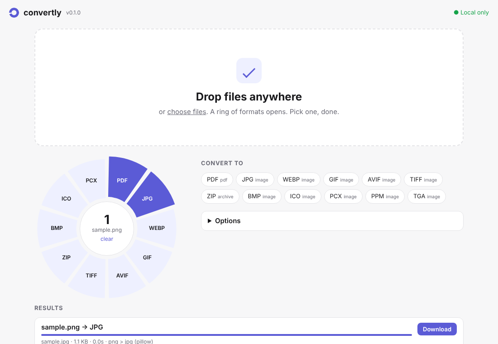

<h1 align="center">convertly</h1>

<p align="center">
  <b>Private, local file conversion.</b> One command, one Python call, or one drag in your browser.<br>
  Nothing is uploaded. Ever.
</p>

<p align="center">
  <a href="https://github.com/Ethos6/convertly/actions/workflows/ci.yml"></a>
  
  
  <a href="LICENSE"></a>
</p>

<p align="center"></p>

```bash
pip install convertly-cli

convertly convert photo.heic --to jpg
convertly convert *.png --to webp --quality 80 -o web/
convertly convert report.docx --to pdf          # uses LibreOffice if present, falls back without it
convertly convert data.xlsx --to json
convertly convert talk.mp4 --to mp3
convertly serve                                  # drag-and-drop UI at http://127.0.0.1:8765
```

## Why convertly

- **Routes for you.** Every converter is an edge in a graph; convertly finds the cheapest chain
  (`docx → md → pdf`, `csv → xlsx → pdf`, …) and tells you which one it took (`--dry-run`).
- **Never clobbers anything.** Results land next to the original (`photo.jpg`, then `photo (1).jpg`).
  Names are claimed atomically, so parallel jobs never collide, and a failed conversion leaves nothing behind.
  The source file is never overwritten, even with `--overwrite`.
- **Safe with untrusted files.** Zip-slip, symlink and zip-bomb checks on archives; XML parsed without entity
  expansion; YAML with `safe_load`; Pillow decompression-bomb limits; FFmpeg restricted to local files;
  Pandoc sandboxed; CSV/XLSX output can't smuggle spreadsheet formulas. See [SECURITY.md](SECURITY.md).
- **Strips location data.** EXIF and GPS metadata are dropped from converted images.
- **Works everywhere Python does.** `pip install` on Windows, macOS and Linux. No installer, no admin rights.
- **Scriptable.** JSON output (`--json`), meaningful exit codes, a small Python API, a polling folder watcher,
  and a plugin entry point for your own converters.
- **Local web UI.** `convertly serve` opens a drag-and-drop page with a ring of the formats that fit your files.
  It binds to 127.0.0.1, uses a private per-run token and strict CSP, and loads nothing from the internet.

## What it converts

Built in (no other software needed):

| From | To |
|---|---|
| **Images** PNG, JPG, WEBP, AVIF¹, GIF (animated), TIFF, BMP, ICO, TGA, PPM, PCX, HEIC² | each other, PDF (multi-page for GIF/TIFF); resize, grayscale, quality |
| **PDF** | TXT, PNG / JPG / WEBP / TIFF (one per page), split into pages; `convertly pdf merge / split / compress` |
| **Data** JSON, JSON Lines, YAML, TOML, XML, CSV, TSV | each other (nested data is flattened for tables) |
| **Spreadsheets** XLSX | CSV, TSV, JSON, YAML, XML, TOML, and back (numbers typed, leading zeros kept) |
| **Documents** DOCX, Markdown, HTML, TXT | DOCX ↔ Markdown, Markdown → HTML / PDF / DOCX, TXT → PDF / DOCX / HTML, HTML → TXT |
| **Archives** ZIP, TAR, TAR.GZ, TAR.BZ2, TAR.XZ | each other, extract to a folder; any single file → ZIP |

With optional engines (found automatically on `PATH`; check with `convertly engines`):

| Engine | Adds |
|---|---|
| [FFmpeg](https://ffmpeg.org) | Audio MP3, WAV, FLAC, OGG, OPUS, M4A, AAC · Video MP4, WEBM, MKV, MOV, AVI, MPG · video → audio, video → GIF, GIF → video |
| [LibreOffice](https://www.libreoffice.org) | DOC, DOCX, ODT, RTF, XLS, XLSX, ODS, PPT, PPTX, ODP → PDF and between Office formats |
| [Pandoc](https://pandoc.org) | Markdown, HTML, DOCX, ODT, EPUB, LaTeX, RST ↔ each other (e-books!) |

¹ when your Pillow build includes AVIF · ² `pip install "convertly-cli[heic]"`

## Command line

```text
convertly convert FILES... --to FMT [-o DIR] [-j N] [-r] [--overwrite] [--dry-run] [--json]
                  [-q 1-100] [--width PX] [--height PX] [--grayscale] [--dpi N] [--pages 1-3,5]
                  [--sheet NAME] [--audio-bitrate 192k] [--crf N] [--timeout SEC]
convertly formats [FILE|FORMAT]     # what can this become?
convertly route docx pdf            # which steps would be used?
convertly engines                   # which optional engines are installed?
convertly pdf merge a.pdf b.pdf -o both.pdf | pdf split f.pdf --pages 2-4 | pdf compress f.pdf
convertly watch ~/Inbox --to pdf [--move-originals]
convertly serve [--port 8765] [--no-browser]
```

`FILES` may be files, folders (`-r` for sub-folders) or glob patterns (expanded by convertly, so they work on
Windows too). Exit code is `0` when everything converted, `1` when something failed, `2` for usage errors.

## Python

```python
from convertly import convert, convert_many, Options, targets

convert("scan.png", "pdf")
convert("photo.jpg", "webp", options=Options(quality=80, width=1600), out_dir="web")
results = convert_many(["a.docx", "b.docx"], "pdf", jobs=4)
print([r.to_dict() for r in results])
print(sorted(targets("xlsx")))
```

### Plugins

Expose a function under the `convertly.converters` entry point group:

```toml
[project.entry-points."convertly.converters"]
mything = "mypkg.convertly_plugin:register"
```

```python
def register(reg):
    reg.add("foo", ["json", "csv"], my_convert_fn, engine="mypkg")
```

See [docs/ADDING-A-CONVERTER.md](docs/ADDING-A-CONVERTER.md).

## Privacy

convertly never sends your files anywhere and has no telemetry or update check. The web UI listens on
127.0.0.1 only (unless you pass `--host`), and its page loads no third-party assets.

## Development

```bash
git clone https://github.com/Ethos6/convertly && cd convertly
python -m venv .venv && . .venv/bin/activate
pip install -e ".[dev]"
pytest                       # engine tests skip themselves when FFmpeg / LibreOffice / Pandoc are missing
ruff check src tests && ruff format --check src tests
```

Publishing and repository protection: [docs/PUBLISHING.md](docs/PUBLISHING.md).

How it compares with [Filee](https://github.com/KnifeLemon/Filee), the project that inspired it, and the design
decisions behind it: [docs/RESEARCH.md](docs/RESEARCH.md). Contributions welcome: [CONTRIBUTING.md](CONTRIBUTING.md).

## License

MIT © 2026 Atomesus Team and convertly contributors. convertly is written from scratch and shares no code with
other converters. Optional engines are separate programs under their own licenses.
